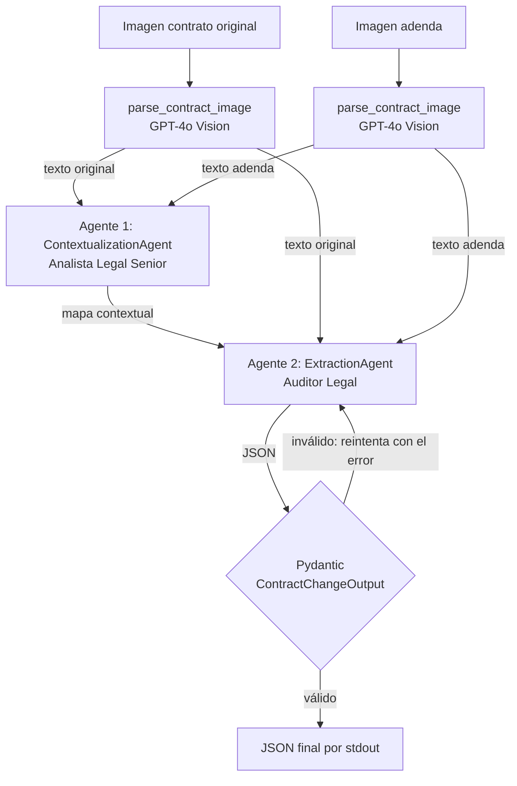

# LegalMove — Agente Autónomo de Comparación de Contratos

**Proyecto Integrador Final · Henry AI Engineer · Módulo 4**

Sistema multi-agente que recibe **dos imágenes escaneadas** (contrato original + adenda), las lee con
**GPT-4o Vision**, y mediante **dos agentes especializados** devuelve un **JSON validado con Pydantic**
con las secciones modificadas, los temas legales afectados y un resumen de los cambios. Todo el flujo
queda trazado en **Langfuse**.

## El problema

LegalMove procesa miles de enmiendas de contratos por mes. El equipo de Compliance dedica más de
40 horas semanales a compararlas a mano con el original: es lento, propenso a errores y no escala.
Este sistema automatiza la comparación y entrega un resultado estructurado que otros sistemas pueden consumir.

## Arquitectura



**Handoff:** el Agente 1 solo construye contexto (estructura, propósito, correspondencia entre secciones) y
**no** extrae cambios. El Agente 2 recibe ese mapa **más** los dos textos y es el único responsable de
detectar y clasificar los cambios (ADICIÓN / ELIMINACIÓN / MODIFICACIÓN).

### Jerarquía de la traza en Langfuse

```
contract-analysis                      (span raíz: input = imágenes, output = JSON final, latencia total)
├── parse_original_contract            (generation GPT-4o Vision: tokens in/out, latencia, texto extraído)
├── parse_amendment_contract           (generation GPT-4o Vision)
├── contextualization_agent            (agent)
│   └── RunnableSequence → ChatOpenAI  (generation: prompt, respuesta, tokens, costo, latencia)
└── extraction_agent                   (agent: attempts, validación)
    ├── ChatOpenAI                     (generation)
    └── pydantic_validation            (guardrail: cada intento de validación; si falla, queda con el error)
```

## Estructura del repositorio

```
.
├── src/
│   ├── main.py                              # entry point + orquestación del pipeline y spans
│   ├── image_parser.py                      # validación, base64 y llamada multimodal a GPT-4o
│   ├── models.py                            # ContractChangeOutput (Pydantic)
│   ├── agents/
│   │   ├── contextualization_agent.py       # Agente 1
│   │   └── extraction_agent.py              # Agente 2 + validación con reintentos
│   ├── config.py · errors.py · llm.py · tracing.py
├── data/test_contracts/                     # 2 pares de contratos (4 imágenes) + README con resultados esperados
├── scripts/generate_test_contracts.py       # regenera las imágenes de prueba
├── tests/                                   # 22 tests offline (no usan la API)
├── requirements.txt · requirements-dev.txt · .env.example
```

## Instalación

Requiere Python 3.10+.

```powershell
# 1. Entorno virtual
python -m venv venv
.\venv\Scripts\Activate.ps1          # Git Bash: source venv/Scripts/activate · macOS/Linux: source venv/bin/activate

# 2. Dependencias
pip install -r requirements.txt

# 3. Variables de entorno
copy .env.example .env               # macOS/Linux: cp .env.example .env
# Editá .env y pegá tus claves
```

| Variable | De dónde sale |
|---|---|
| `OPENAI_API_KEY` | platform.openai.com → API keys (el modelo `gpt-4o` debe estar habilitado en tu cuenta) |
| `LANGFUSE_PUBLIC_KEY`, `LANGFUSE_SECRET_KEY` | cloud.langfuse.com → proyecto → Settings → API Keys |
| `LANGFUSE_HOST` | `https://cloud.langfuse.com` (región EU) o `https://us.cloud.langfuse.com` (US) |

Opcionales: `OPENAI_MODEL` (default `gpt-4o`), `VISION_DETAIL` (`high`/`low`), `OPENAI_TIMEOUT`, `OPENAI_MAX_RETRIES`.

## Uso

```powershell
# Caso 1: cambios simples
python src/main.py data/test_contracts/par1_original.png data/test_contracts/par1_adenda.png

# Caso 2: cambios complejos
python src/main.py data/test_contracts/par2_original.png data/test_contracts/par2_adenda.png

# Opciones: guardar el JSON, cambiar de modelo, desactivar Langfuse
python src/main.py a.png b.png --output resultado.json
python src/main.py a.png b.png --model gpt-4o-mini --no-trace
```

El **JSON** sale por *stdout*; el progreso y los errores salen por *stderr* (se puede redirigir el JSON sin ruido).

### Salida esperada (formato)

```json
{
  "sections_changed": ["Cláusula TERCERA - Precio y forma de pago", "Cláusula SEGUNDA - Vigencia y vencimiento"],
  "topics_touched": ["Precio", "Plazo y vigencia"],
  "summary_of_the_change": "MODIFICACIÓN - Cláusula TERCERA: el monto mensual pasa de USD 2.500 a USD 2.850 ... MODIFICACIÓN - Cláusula SEGUNDA: el vencimiento pasa del 28/02/2026 al 31/08/2026."
}
```

### Códigos de salida

| Código | Significado |
|---|---|
| 0 | OK |
| 1 | Falta configuración (`OPENAI_API_KEY`, valores inválidos) |
| 2 | Imagen inválida (no existe, formato no soportado, vacía, muy grande, dañada) |
| 3 | Falló el parsing con visión (clave inválida, 429, timeout, red, respuesta vacía) |
| 4 | Falló la ejecución de un agente |
| 5 | El JSON del Agente 2 no cumplió el esquema tras los reintentos |

## Tests

```powershell
pip install -r requirements-dev.txt
python -m pytest -q
```

Los 22 tests corren **sin llamar a OpenAI ni a Langfuse** (modelos y clientes simulados). Cubren el modelo Pydantic,
la validación de imágenes, el armado del payload multimodal, el manejo de errores 429/rechazos/respuestas vacías,
los reintentos de validación del Agente 2 y el pipeline completo.

## Decisiones técnicas

**¿Por qué dos agentes y no uno?** Separar *entender* de *auditar* reduce errores. Un único prompt que debe
mapear la estructura de dos documentos y a la vez detectar cada diferencia tiende a omitir cambios o a
inventarlos. El Agente 1 fija un marco compartido (qué cláusula de la adenda corresponde a cuál del original,
incluyendo cláusulas nuevas sin contraparte) y el Agente 2 trabaja sobre ese marco con una única misión.
Además, cada etapa se puede auditar y depurar por separado en Langfuse.

**¿Por qué GPT-4o para el parsing?** Los contratos escaneados tienen jerarquía (cláusulas, incisos, numeración)
que un OCR tradicional aplana o ensucia. Un modelo de visión entiende el layout y devuelve texto con la estructura
preservada. Se usa `detail: "high"` para leer bien el texto chico y `temperature=0` para transcripción determinista.

**Diseño de los system prompts.** Cada agente tiene un rol y límites explícitos:
- *Analista Legal Senior* (Agente 1): describe estructura, propósito y correspondencia; tiene **prohibido** listar cambios.
- *Auditor Legal* (Agente 2): compara literalmente, clasifica ADICIÓN/ELIMINACIÓN/MODIFICACIÓN, cita valor anterior y nuevo,
  y solo reporta lo respaldado por el texto (reduce alucinaciones).
- Ambos tratan el contenido de los documentos como **datos**, no como instrucciones (defensa básica contra prompt injection).
- El prompt de visión prohíbe corregir, resumir o inventar, y obliga a marcar `[ilegible]`.

**Validación de salida.** El Agente 2 usa `response_format=json_object` y el resultado se valida con
`ContractChangeOutput.model_validate()`. El modelo usa `extra="forbid"` (no admite campos de más), listas sin
elementos vacíos y resumen no vacío. Si falla, se reintenta hasta 2 veces **mostrándole al modelo su respuesta y el
error exacto**; si sigue fallando se lanza `OutputValidationError` con un mensaje claro. Cada intento queda
como span `pydantic_validation` en Langfuse.

**Manejo de errores.** Validación previa de archivos (existencia, JPEG/PNG, tamaño, firma binaria real vs. extensión),
clientes con timeout y reintentos con backoff ante 429/5xx, traducción de errores de OpenAI a mensajes claros,
claves únicamente por variables de entorno y falla temprana si falta alguna.

**Observabilidad.** Una traza por ejecución con spans hijos por etapa, con input, output, latencia y tokens.
Las llamadas a LangChain se capturan con el `CallbackHandler` de Langfuse. Si no hay credenciales, el pipeline
funciona igual sin trazas.

## Limitaciones conocidas

- Cada documento es **una sola imagen** (una página). Para contratos multipágina habría que parsear cada página y concatenarlas.
- La calidad depende de la legibilidad del escaneo; imágenes muy borrosas pueden generar `[ilegible]` y cambios no detectados.
- No hay evaluación automática de la precisión de los cambios: el resultado esperado de cada par de prueba está documentado en
  `data/test_contracts/README.md` para contrastarlo manualmente.
- El resumen es un único string: no hay una lista tipada de cambios (el esquema pedido tiene tres campos).
- No es asesoramiento legal: el reporte asiste al equipo de Compliance, que revisa y decide.
